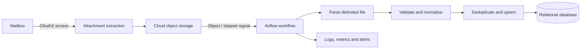

# Email-Based Inventory File Pipeline

## Overview
A scheduled ingestion pattern for receiving inventory extracts as email attachments, landing source files in cloud object storage, and loading validated records into a relational database.

This is a generalized portfolio description based on documented workflow notes, not the original employer implementation.

## Architecture

## Workflow
1. Authenticate to the mailbox using an OAuth-based flow.
2. Identify and retrieve the expected inventory attachment.
3. Land the source file in object storage.
4. Trigger downstream orchestration when the object is available.
5. Parse the file using its expected encoding and delimiter.
6. Validate and normalize records.
7. Apply deduplication and upsert logic to the target database.
8. Record processing status and surface failures through operational alerting.

The documented source format was a UTF-16-LE, tab-delimited SAP export. Vendor-specific samples and production identifiers are intentionally excluded.

## Reliability and quality
- Use a stable business key and deterministic upsert behavior so a repeated file does not create duplicate current records.
- Validate required columns, parseability, required values, and duplicate business keys before loading.
- Retain source-file identity and processing status in operational metadata.
- Distinguish extraction, parsing, validation, and database-write failures for targeted recovery.
- Keep mailbox credentials and database secrets out of source code; use managed secret storage and environment-specific configuration.

## Monitoring
Track file arrival, records read, records accepted/rejected, target rows inserted/updated, duration, and final run status. Alerts should identify the failed stage without exposing secrets or customer data.

The documented workflow included mailbox attachment ingestion, object storage, Airflow orchestration, parsing, PostgreSQL upsert, operational metrics/alerts, and a separate BigQuery transfer path.

*Architecture reconstructed from documented workflow notes for portfolio explanation; not an original system diagram.*
