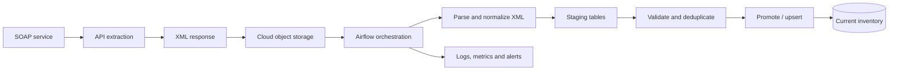

# SOAP/XML API Inventory Pipeline

## Overview
An API ingestion pattern that extracts inventory data from a SOAP service, lands the XML response in cloud object storage, and processes it into a relational database through staging and promotion steps.

Generalized portfolio description based on documented workflow notes; not the original employer implementation.

## Architecture

## Workflow
1. Call the SOAP endpoint and retrieve the XML payload.
2. Store the raw response in object storage for traceability and replay.
3. Trigger downstream workflow after the source object is available.
4. Parse XML and map source fields into a normalized structure.
5. Load normalized records into staging.
6. Validate and deduplicate before promoting.
7. Upsert accepted records into the current-state target.
8. Publish run status, processing metrics, and failure alerts.

## Reliability and quality
- Preserve raw payloads for replay where retention policy allows.
- Separate ingestion from target promotion to prevent partially validated data becoming current.
- Define deterministic keys and precedence rules for deduplication.
- Check required fields, parse errors, duplicate keys, and reasonable record-count expectations.
- Capture API outcome, response/file identity, rows staged/promoted, duration, and failure stage.

Use bounded retries for transient failures. Avoid blindly retrying non-retryable business or schema errors. Keep endpoint credentials and environment-specific values in managed configuration/secrets.

The documented workflow used SOAP/XML extraction, object storage, Airflow, PostgreSQL staging/promotion, deduplication, validation, operational metrics/alerts, and CI/CD.

*Architecture reconstructed from documented workflow notes for portfolio explanation; not an original system diagram.*
