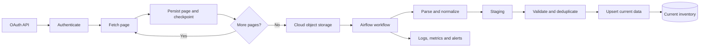

# OAuth Paginated API Inventory Pipeline

## Overview
A batch ingestion pattern for retrieving inventory data from an OAuth-protected API that returns results across multiple pages. Extracted data is landed in object storage and loaded into staging/current database tables.

Generalized portfolio description based on documented workflow notes; not the original employer implementation.

## Architecture

## Workflow
1. Obtain an access token through the configured OAuth flow.
2. Request API pages using the service pagination contract.
3. Persist progress/checkpoint information so extraction can resume after interruption.
4. Land extracted payloads in object storage.
5. Orchestrate parsing and loading after data is available.
6. Normalize records and load staging tables.
7. Validate and deduplicate before upserting current-state records.
8. Track run status, counts, duration, and failures.

## Reliability and quality
- Record the last successfully persisted page or continuation token; advance the checkpoint only after durable persistence.
- Resume from the last durable checkpoint rather than restarting the entire extraction unnecessarily.
- Make page persistence and database writes safe to repeat using stable keys and deterministic upserts.
- Check required fields, schema compatibility, duplicate keys, and expected record-count behavior.
- Record pages requested/completed, records extracted/staged/promoted, retries, duration, and final status.

Respect API rate limits and token expiry. Use bounded retries for transient network/service errors and make authentication failures visible. Protect tokens and secrets using managed secret storage.

The documented workflow included OAuth2 API access, pagination, resume checkpoints, object storage, Airflow, PostgreSQL staging/current tables, deduplication, upsert, validation, monitoring, and CI/CD.

*Architecture reconstructed from documented workflow notes for portfolio explanation; not an original system diagram.*
